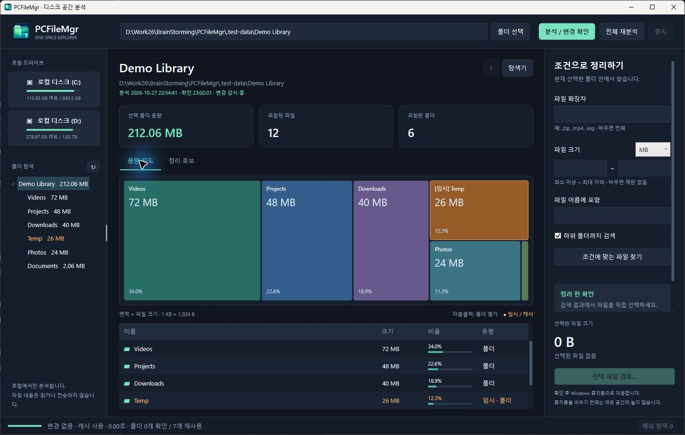
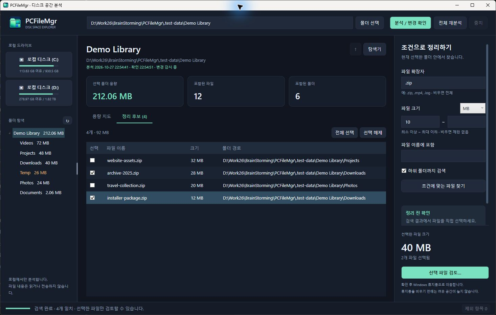
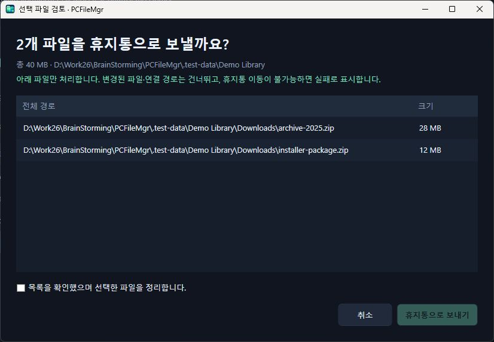

<div align="center">
  
  <h1>PCFileMgr</h1>
  <p><strong>어디에 공간을 쓰고 있는지 보고, 필요한 파일만 골라 정리하세요.</strong></p>
  <p>Windows용 디스크 용량 시각화 · 폴더 탐색 · 조건별 파일 정리</p>
  <p>
    
    
    
  </p>
  <p><a href="https://github.com/youngmuk/PCFileMgr/releases/latest">Windows 실행 파일 다운로드</a> · <a href="#빠른-시작">빠른 시작</a> · <a href="#화면-둘러보기">화면 안내</a> · <a href="#필요한-파일만-정리하기">파일 정리</a> · <a href="#분석-캐시">분석 캐시</a> · <a href="#소스에서-빌드하기">빌드</a></p>
</div>



> 화면은 실제 앱에서 촬영했습니다. `Demo Library`의 파일명과 크기는 사용법 설명을 위해 만든 샘플입니다.

## 주요 기능

- **면적으로 읽는 용량** — 파일·폴더가 클수록 넓게 표시되는 트리맵으로 공간 사용을 파악합니다.
- **탐색기처럼 이동** — 폴더 트리와 더블클릭으로 이동하고, 왼쪽 패널 너비를 드래그해 조절합니다.
- **조건을 조합해 검색** — 확장자, 최소·최대 크기, 파일명과 하위 폴더 포함 여부를 함께 지정합니다.
- **선택 → 검토 → 휴지통** — 원하는 파일만 직접 선택하고 최종 목록을 검토합니다.
- **분석 결과 재사용** — 문서 폴더에 캐시를 저장하고, 실행 중에는 변경된 폴더만 갱신합니다.
- **임시 항목 구분** — 임시·캐시 파일과 폴더를 주황색과 `임시` 표시로 구분합니다.

## 빠른 시작

1. [**최신 Release**](https://github.com/youngmuk/PCFileMgr/releases/latest)에서 Windows x64용 `PCFileMgr.exe`를 내려받습니다.
2. EXE를 실행합니다. **별도 .NET 설치 없이 실행되는 자체 포함 배포본**입니다.
3. 왼쪽 드라이브 또는 상단 **폴더 선택**으로 분석할 위치를 고릅니다.
4. 분석이 끝나면 큰 사각형부터 살펴보세요. 폴더를 **더블클릭**하면 내부 항목을 볼 수 있습니다.

Windows x64 환경에서 실행합니다. 관리자 권한을 자동으로 요청하지 않으며, 현재 계정이 읽을 수 있는 파일을 집계합니다. EXE는 디지털 서명되지 않았습니다.

특정 폴더로 바로 시작할 수도 있습니다.

```powershell
.\PCFileMgr.exe "D:\자료"
```

소스만 내려받았다면 [소스에서 빌드하기](#소스에서-빌드하기)를 참고하세요.

## 화면 둘러보기

위 전체 화면에서 각 영역은 다음 역할을 합니다. 이미지를 클릭하면 크게 볼 수 있습니다.

| 위치 | 영역 | 사용 방법 |
|---|---|---|
| **맨 위** | 경로와 분석 버튼 | 경로 입력 후 Enter 또는 **분석 / 변경 확인**을 누릅니다. **전체 재분석**은 캐시를 무시합니다. |
| **왼쪽 위** | 로컬 드라이브 | 드라이브의 여유 공간을 확인하고 분석할 드라이브를 선택합니다. |
| **왼쪽 아래** | 폴더 탐색 | 원하는 폴더를 선택합니다. **오른쪽 세로 경계**를 드래그하면 패널이 넓어집니다. |
| **가운데 위** | 경로·캐시 상태·요약 | 선택한 폴더의 용량, 파일·폴더 수와 마지막 분석/확인 시각을 보여줍니다. |
| **가운데 지도** | 용량 트리맵 | **면적은 크기**, 숫자는 용량과 비율입니다. 폴더는 더블클릭으로 열고 파일은 클릭해 목록에서 확인합니다. |
| **지도 아래** | 상세 목록 | 이름, 크기, 비율, 유형을 확인합니다. 0바이트 항목도 목록에는 나타납니다. |
| **오른쪽** | 정리 조건과 선택 요약 | 검색 조건을 입력하고 선택한 파일 수·합계를 확인합니다. |
| **맨 아래** | 진행 상태·제외 항목 | 분석 진행, 캐시 재사용 폴더 수, 접근 불가 등 제외 사유를 확인합니다. |

**주황색은 삭제 권장이 아닙니다.** `Temp`, `Cache`, `.tmp`, `.partial` 등 이름 규칙에 따른 시각적 분류입니다. 필요한 파일인지 직접 확인하세요. 일반 항목의 다른 색상은 항목을 구분하기 위한 것입니다.

## 필요한 파일만 정리하기

### 1. 조건을 입력하고 검색

오른쪽에서 조건을 입력한 뒤 **조건에 맞는 파일 찾기**를 누릅니다. 검색 범위는 현재 선택한 폴더이며, **하위 폴더까지 검색**을 체크하면 내부까지 찾습니다.

| 찾으려는 파일 | 확장자 | 최소 | 최대 | 단위 |
|---|---|---:|---:|---|
| 1GB 이상 동영상 | `.mp4, .mkv, .mov` | 1 | 비움 | GB |
| 10MB 이상 압축 파일 | `.zip, .7z` | 10 | 비움 | MB |
| 10MB 이하 로그 | `.log` | 비움 | 10 | MB |
| 이름에 backup이 포함된 파일 | 비움 | 비움 | 비움 | 무관 |
| 0바이트 파일 | 비움 | 0 | 0 | B |

이름 검색은 **파일 이름에 포함**에 입력합니다. 모든 조건은 **AND**로 결합하며, 빈 조건은 제한하지 않습니다. 크기는 최소·최대 경계를 포함하고 `1 KB = 1,024 B`입니다. 확장자는 쉼표·공백·세미콜론으로 구분하며 대소문자를 구별하지 않습니다. 확장자 없는 파일은 `<없음>`으로 찾습니다.

### 2. 검색 결과에서 파일 선택



| 화면 영역 | 설명 |
|---|---|
| 오른쪽 조건 | 예제에서는 **.zip / 최소 10 / MB / 하위 폴더 포함**으로 검색했습니다. |
| 가운데 결과 | 조건에 맞는 **4개, 92MB**가 표시됩니다. 검색만으로 파일이 선택되거나 삭제되지는 않습니다. |
| 왼쪽 체크박스 | 정리할 두 파일을 직접 선택했습니다. **전체 선택 / 선택 해제**도 사용할 수 있습니다. |
| 오른쪽 아래 | 선택한 **2개 파일, 40MB**를 확인한 뒤 **선택 파일 검토…**를 누릅니다. |

조건을 바꾸면 이전 검색 결과와 선택이 초기화됩니다. 다시 검색한 후 선택하세요.

### 3. 최종 목록 검토



1. **상단**에서 파일 개수·총용량·대상 폴더를 확인합니다.
2. **가운데 목록**에서 각 파일의 전체 경로와 크기를 확인합니다.
3. 맞으면 **하단 확인란**을 체크하고 **휴지통으로 보내기**를 누릅니다. 진행하지 않으려면 **취소**합니다.

> **휴지통을 비우기 전에는 여유 공간이 늘지 않습니다.** 복원이 필요하면 Windows 휴지통을 이용하세요. PCFileMgr는 휴지통을 비우지 않습니다.

- 정리 대상은 **파일**입니다. 폴더 전체를 재귀 삭제하지 않습니다.
- 시스템·읽기 전용 파일과 연결 경로는 정리 대상에서 제외합니다.
- 삭제 직전에 크기·수정/생성 시각과 경로를 다시 확인합니다. 분석 이후 변경된 파일은 건너뜁니다.
- 휴지통 이동이 불가능하면 실패로 표시합니다. **영구 삭제로 자동 전환하지 않습니다.**
- 화면 촬영에서는 최종 삭제를 실행하지 않았습니다.

## 분석 캐시

캐시 저장 위치는 실행 파일 위치와 관계없이 **Windows 문서 폴더**입니다.

```text
문서/
└─ PCFileMgr/
   └─ Cache/
      ├─ last-root.txt
      ├─ <분석 경로 해시>.scan.gz
      └─ <분석 경로 해시>.<변경 기록>.delta.gz
```

| 상황 | 동작 |
|---|---|
| 처음 분석 | 파일 메타데이터를 읽어 용량을 계산하고 저장합니다. |
| 실행 중, 변경 없음 | 저장된 메모리 결과를 재사용하며 폴더를 다시 조회하지 않습니다. |
| 실행 중, 변경 발생 | 변경된 폴더를 확인하고 상위 폴더 합계를 갱신합니다. |
| 앱 재실행 | 저장된 결과를 먼저 표시한 뒤 종료 중 변경 여부를 **전체 메타데이터와 대조**합니다. |
| 캐시 손상 또는 감시 실패 | 새 분석 또는 전체 메타데이터 대조로 복구합니다. |

**현재 버전은 재실행 후 전체 변경 대조가 필요합니다.** 파일 수가 많으면 이 과정에도 시간이 걸립니다. USN 변경 저널·DB 지연 로딩은 아직 구현되지 않았습니다.

캐시는 경로·크기·시각·속성을 저장하며 파일 내용은 저장하지 않습니다. 같은 Windows 계정에서 EXE 위치를 바꿔도 재사용합니다. 이전 `%LOCALAPPDATA%\PCFileMgr\Cache`는 필요할 때 읽어 검증 후 새 위치에 저장하며 원본을 삭제하지 않습니다.

문서 폴더가 OneDrive 등으로 연결되어 있으면 해당 동기화 설정이 캐시에도 적용됩니다. 캐시에는 파일 경로가 포함되므로 공개 저장소에 올리지 마세요.

## 단축키

| 키 | 동작 |
|---|---|
| `Ctrl + L` | 경로 입력으로 이동 |
| `Enter` | 입력한 경로 분석 / 선택한 폴더 열기 |
| `Alt + ↑` | 분석 범위 안에서 상위 폴더로 이동 |
| `F5` | 변경 확인 |
| `Shift + F5` | 캐시를 무시하고 전체 재분석 |
| `Esc` | 진행 중인 작업 중지 요청 |
| 패널 경계 선택 후 `← / →` | 왼쪽 패널 너비 조절 |

## 알아두면 좋은 점

- 표시되는 크기는 **논리적 파일 크기**입니다. 압축·희소 파일, 하드 링크, NTFS 메타데이터 때문에 Windows의 실제 디스크 사용량과 다를 수 있습니다. 하드 링크는 경로마다 집계합니다.
- 숨김 파일도 읽을 수 있으면 집계합니다. 접근 거부, 연결 지점·심볼릭 링크, 휴지통·볼륨 관리 폴더와 일부 클라우드 항목은 제외할 수 있습니다.
- 네트워크·UNC 경로는 지원하지 않습니다. 로컬 고정/이동식 드라이브를 대상으로 합니다.
- 아주 작은 항목은 그래프에서 묶어 표시하지만 목록에서는 개별 확인할 수 있습니다.
- 분석·검증이 취소되거나 실패하면 파일 정리가 잠깁니다. `F5`로 확인을 완료하세요.

## 소스에서 빌드하기

**Windows + .NET 10 SDK**가 필요합니다. 저장소 루트에서 실행하세요.

```powershell
# Windows x64 자체 포함 단일 EXE
.\Build.ps1

# 결과
.\artifacts\PCFileMgr\PCFileMgr.exe

# 핵심 기능과 안전장치 검증
.\Test.ps1
```

`Run.cmd`는 배포 EXE가 있으면 실행하고, 없으면 SDK로 소스를 실행합니다. 작은 프레임워크 의존 배포본은 `Build.ps1 -FrameworkDependent`로 만들 수 있으며, 실행 PC에 .NET 10 Desktop Runtime이 필요합니다.

일반 테스트는 사용자 파일을 삭제하지 않습니다. `Test.ps1 -RecycleSmoke`는 테스트가 만든 임시 파일 1개의 실제 휴지통 이동까지 확인하는 선택적 검사입니다.

| 폴더 | 역할 |
|---|---|
| `PCFileMgr` | WPF 화면, 트리맵 렌더링, Windows 휴지통 연동 |
| `PCFileMgr.Core` | 분석, 캐시, 변경 감시, 필터, 경로 검증 |
| `PCFileMgr.Tests` | 별도 테스트 프레임워크 없이 실행하는 검증 프로그램 |
| `docs/images` | 실제 앱 화면 캡처 |

캐시 구조와 검증 이력, 향후 성능 개선 검토는 [기술 노트](docs/technical-notes.md)에 정리했습니다. 아이콘 생성 정보는 [아이콘 기록](PCFileMgr/Assets/IconSource.md)을 참고하세요.
